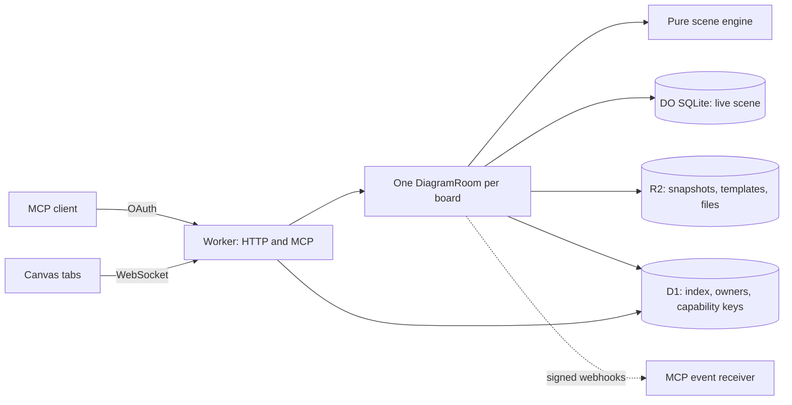

# Architecture and contracts

For local and deployment instructions, see [setup](setup.md). Product priorities
live in [ROADMAP.md](../ROADMAP.md).

## State ownership

HTTP and MCP use the same room operations; persistence, undo, and collaboration
must converge there. Scene transformations have no I/O. MCP is stateless: every
board tool receives a share link rather than a server-side agent session.

D1 schema creation happens on first use in `src/worker/store.ts`; a fresh database
needs no separate migration command. D1 also stores snapshot metadata, event
subscriptions/signing secrets, and encrypted ChatGPT session state. `OAUTH_KV`
stores browser sessions, login state, and MCP OAuth tokens/grants. R2 paths are
`snapshots/<diagram>/<id>.json`, `templates/<id>.json`, and `files/<diagram>/<file>`.

## Collaboration and edits

Human updates use Excalidraw element versions: higher version wins, with lower
`versionNonce` breaking a tie. Tabs reconcile incoming elements with Excalidraw.
Deletes are tombstones; the room purges them after seven days only while no tab
is connected. A client offline beyond that window can miss a deletion. Presence
lives on WebSocket attachments so it survives room hibernation.

Agent patches run on cloned scene state, then persist in a SQLite transaction
before broadcasting. Operations address IDs, unique labels, or earlier batch
references; ambiguous labels fail. A patch can partially succeed: inspect each
operation result before describing the edit as successful.

`apply_patch`, `layout`, and Mermaid import take an automatic snapshot before
mutation. `tidy` snapshots only when something will change. Restore validates the
saved scene and creates a safety snapshot before replacing the current scene;
its result includes `undoSnapshotId`.

Snapshots span R2 and D1 and are **not atomic**. A failure between the object write
and metadata insertion can orphan data. Listings expose the latest 30 by default,
with no pagination or automatic retention. Keep these limits in mind before
promising complete history or bounded storage.

Creation initializes the destination room and copies template files before
publishing metadata and owner together in a D1 transaction. On failure it attempts
to revoke and erase that destination. Cleanup can itself fail; an aggregate error
identifies the incomplete destination. This compensation is not a cross-store
transaction and must never erase the source board/template.

### Tidy versus layout

Tidy preserves connections, labels, colors, and relative order while repairing
alignment, spacing, frame bounds, wrapping, and arrow routes. It runs on frames
touched by an agent patch. Grouped artwork moves together; new/edited blocks give
way before existing work. VPSC/WebCola minimizes displacement under separation
constraints; separation wins when it conflicts with alignment. Dagre layout is
an explicit rearrangement and stays opt-in. The orthogonal-routing benchmark
baseline is frozen (see [product constraints](../PRODUCT.md#capabilities-and-constraints)).

### Browser-dependent operations

Screenshots, Mermaid conversion, and focus/point need a real Excalidraw tab. The
room targets the most recently focused tab, waits briefly for reconnect, then
reports “open the share link” if none exists. Targeting every tab could return
another person's selection or viewport. Focus/point changes no scene elements
and creates no version. Semantic reads and edits work without an open tab.

## Identity and board access

A board link is an editing capability. Both its original key hash and its
server-managed library key can authorize access; neither should appear in logs.
Links do not provide a read-only tier or key rotation.

Browser sign-in and MCP consent use the same verified shared Auth subject.
`openid-client` validates the upstream OIDC response; the OAuth provider validates
MCP bearer tokens. The MCP SDK's `authInfo` is a caller-supplied claim, so it must
only receive the verified principal. Every MCP call requires `mcp:read`; mutations
and view-control tools also challenge for `mcp:write`. A token does not replace the
board link.

Private libraries and saved templates are owner-scoped. Saving a template requires
ownership of the source board. Shared-link collaborators can draw without signing
in, but cannot delete the owner's board. Legacy boards remain accessible by their
original links and require explicit operator ownership assignment; never infer an
owner from the first visitor or merge identities by email.

Deletion requires an authenticated owner and same-origin HTTP request. It records
a deletion marker, closes sockets, then erases scene data, uploaded files, versions,
metadata, and subscriptions. Owner/deletion records remain so the owner can retry
incomplete erasure through `DELETE /api/diagrams/:id`, even after capability links
have stopped working. Independent template copies survive deletion.

### Library API

`GET /api/diagrams?limit=50&cursor=...` requires a browser session and returns
`{ items, nextCursor }`. Page size defaults to 50, maximum 100. Return the cursor
unchanged; `null` ends pagination. Creation-time/ID ordering prevents newer inserts
from shifting subsequent pages. JSON mutation callers set `Content-Type:
application/json` and the same-origin `Origin` header; malformed JSON or invalid
Zod fields return 400. Invalid board capabilities fail before route body validation.

## MCP result compatibility

Model-facing data tools explicitly return a summary and serialized JSON in
`content`, plus the same data in `structuredContent`. Keep the full text fallback:
clients differ in which channel they expose, and scene IDs or snapshot IDs must
survive text-only consumers. This duplication may increase model context usage.
Array results use object fields such as `{ elements }`, `{ snapshots }`, or
`{ templates }`. Input schemas do not validate outputs; no `outputSchema` is
currently declared.

The app-only `render_scene` returns `{ name, url, elements }` for
`src/view/main.ts` to read directly from `structuredContent`; screenshots use native
image content. The inline roughjs preview renders images, embeds, and iframes as
placeholders, so it is not a full Excalidraw rendering.

The compatibility decision was informed by the
[MCP structured-content guidance](https://modelcontextprotocol.io/specification/2026-07-28/server/tools#structured-content)
and [host precedence reports](https://github.com/modelcontextprotocol/modelcontextprotocol/issues/1624).
Those reports describe version-specific behavior, not guarantees for every host.

## MCP events

Subscriptions use the same capability verification as tools and bind to the
OAuth principal and original consent grant. Before every delivery attempt, the
server rechecks expiry, cancellation, current capability hash, and the grant.
Another installation cannot unsubscribe or rotate that subscription's secret.
KV grant revocation has KV's consistency delay.

Agent edits are withheld unless `include_agent` is requested, preventing feedback
loops. Payloads carry IDs/counts rather than elements; receivers re-read the scene.
Share keys are not repeated in payloads. Deliveries use Standard Webhooks signing,
keep the same event ID on retries, and overlap old/new signing keys for five
minutes. Network errors, 408, 429, and server errors receive up to three attempts;
410 cancels the subscription and 413 is not retried.

Delivery runs off the editing path via `waitUntil`. There is no durable event log
or replay; a restart can silently drop a delivery. Only webhook delivery is
implemented. See [setup](setup.md#mcp-events) for callback trust requirements,
configuration, and host acceptance testing.
